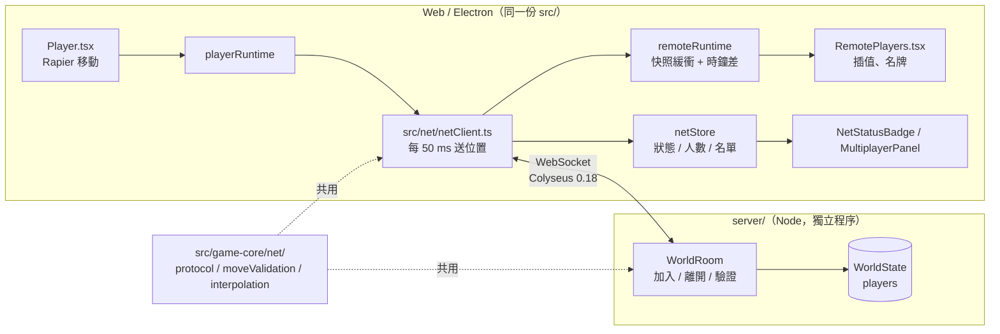

# 多人連線架構（任務 11A–11B）

依使用者提供的〈3D RPG 多人連線技術規劃與 Claude Code 實作規格〉，完成其中 Phase 0–2：Colyseus 遊戲伺服器、在場玩家、移動同步。登入、Supabase、部署、斷線續玩（Phase 3–5）尚未開始。上線的整體規劃（Vercel、Render、Supabase、流程圖）見 `online-plan.md`。

## 現況盤點（Phase 0）

| 項目 | 現況 |
|---|---|
| 3D 引擎 | React Three Fiber + Three.js，物理 Rapier（`@react-three/rapier`） |
| Web / Electron | 同一份前端（`src/`，Vite 建置到 `dist/`）。Electron 開發版載入 Vite 開發伺服器，正式版 `loadFile(dist/index.html)` |
| 遊戲主迴圈 | R3F 的 `useFrame`；遊戲進度由 `LocalAuthority`（`src/game-core/authority/authority.ts`）處理指令與事件 |
| 玩家控制 | `src/world/entities/player/Player.tsx`：Rapier kinematic 角色控制器，每幀寫入 `playerRuntime`（`src/game/player/localRuntime.ts`）。玩家位置不在權威狀態裡，存檔時取快照 |
| 地圖 | 三張地圖在同一個物理世界的不同位置（原點 (0,0)、(2000,0)、(4000,0)），室內子場景在 (1000,1000) 附近；`game-core/world/maps.ts` |
| 套件管理 | pnpm（沿用，未改用文件建議的 bun，見 DECISIONS T-167） |

## 元件與責任

| 位置 | 負責 | 不負責 |
|---|---|---|
| `src/game-core/net/` | 協定（房間名、訊息名、zod 格式、頻率常數）、移動驗證純函式、插值與時鐘同步純函式 | 不 import Colyseus、React、store |
| `server/` | 房間生命週期、玩家 id 與出生點、驗證每一則移動、判斷所在地圖與室內、`/health` | 地形碰撞、任務、背包、戰鬥 |
| `src/net/` | 唯一 import `@colyseus/sdk` 的地方：連線 / 中斷 / 重新連線、回報本機位置、套用位置修正、整理遠端玩家 | 渲染 |
| `RemotePlayers.tsx` | 遠端玩家的模型、動畫、名牌、只顯示同地圖同室內的人 | 物理（遠端玩家沒有碰撞體） |

## 重要決策

- **在場層與遊戲進度分開（T-169）**：多人只同步誰在、在哪、什麼動作。任務、背包、戰鬥仍是各自的 `LocalAuthority`，存檔也照舊在本機。
- **移動由客戶端模擬、伺服器驗證（T-168）**：伺服器沒有地形與碰撞，改成伺服器依輸入模擬會和客戶端的碰撞結果衝突。客戶端回報位置，伺服器用自己的時鐘算這段時間最多能走多遠（`(跑步速度 + 最快突進) × 1.25`、上限 1 秒、外加 1 m），超過、可玩區外、格式不對都不採用，並請客戶端拉回最後的合法位置。
- **合法的瞬移走 `warp`**：地圖出入口、進出室內、落水重生、讀檔、新遊戲時 `Player.tsx` 把 `playerRuntime.warpSeq` 加一，客戶端改送 `warp`。伺服器只檢查間隔（1.5 秒）與落點在可玩範圍內。
- **單一房間（T-169）**：房間名 `world`，選項 `instanceId`、上限 16 人；每個玩家帶伺服器判斷的 `map` / `location`，為之後依地圖分房或 AOI 預留。
- **插值在送出端的時間軸上**：每則移動帶著算出這個位置的那一幀時間 `t`，接收端估計兩邊時鐘差（取延遲最短的那一包，變化時以最多 10% 的速度追上），畫出對方時間「現在 − 100 ms」的位置。停了一陣子再開始走時，補一個還在原地的快照，避免開頭一幀跳過去。

## 資料流（一次移動）

1. `Player.tsx` 本幀算出新位置，寫入 `playerRuntime.position` 與 `positionAt`。
2. `netClient` 每 50 ms 檢查：位置、朝向、動畫有變化（或已經 1 秒沒送）就送 `move {t,x,y,z,yaw,anim}`；`warpSeq` 改變時改送 `warp`。
3. `WorldRoom` 用 zod 檢查格式、每秒最多 30 則，計算地圖與室內，驗證速度；通過就寫入 `PlayerState`，否則送 `correction`（最多每 250 ms 一次）。
4. Colyseus 每 50 ms 把有變化的欄位送給所有客戶端。
5. 其他客戶端的 `onStateChange` 把新的 `t` 與位置放進該玩家的 `SnapshotBuffer`，`RemotePlayers` 每幀取插值後的位置與動畫。

## 已知限制與之後的階段

- 合法瞬移只檢查間隔與落點範圍，惡意客戶端仍可每 1.5 秒瞬移一次；之後依出入口與重生點資料驗證落點。
- 斷線後要按「重新連線」重新加入（伺服器不保留座位）；Phase 3 再做 `allowReconnection` 的斷線續玩。
- 同一台電腦同時開兩個 Electron 視窗與伺服器、機器很忙時，遠端玩家偶爾會停約 0.1 秒再追上；之後可改成依抖動自動調整的呈現延遲。
- 遠端玩家和本機玩家同一個造型（沒有外觀同步）、不同步攻擊與施法動作。
- 新遊戲的玩家都出生在同一點，會疊在一起（沒有玩家之間的碰撞）。
- Colyseus 預設接受任何來源（Electron 的 `file://` Origin 是 `null`）；Phase 4 部署時再設定來源允許清單。
- `?server=` 只能指向 localhost 或建置時 `VITE_GAME_SERVER_URL` 的位址（CSP 限制）；區域網路試玩要用 `VITE_GAME_SERVER_URL=ws://<區網 IP>:2567 pnpm build` 建置。
