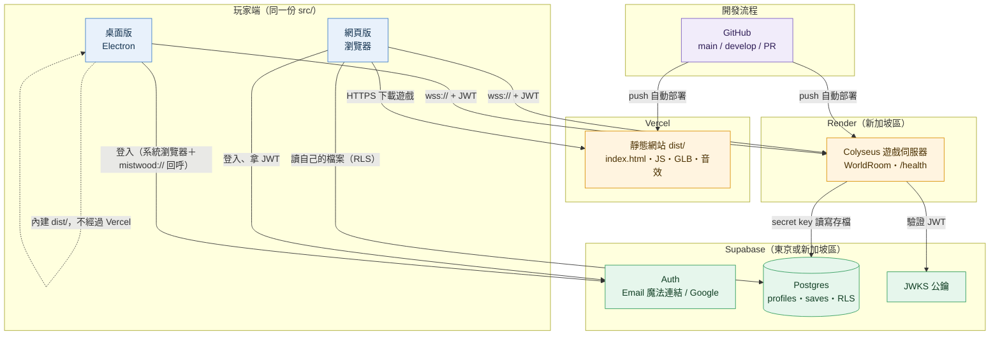
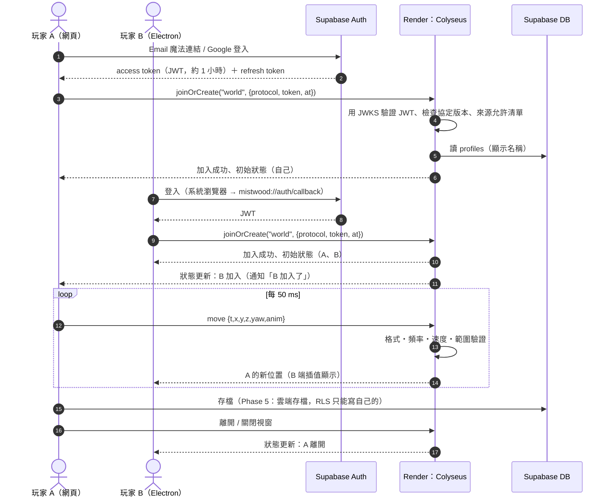
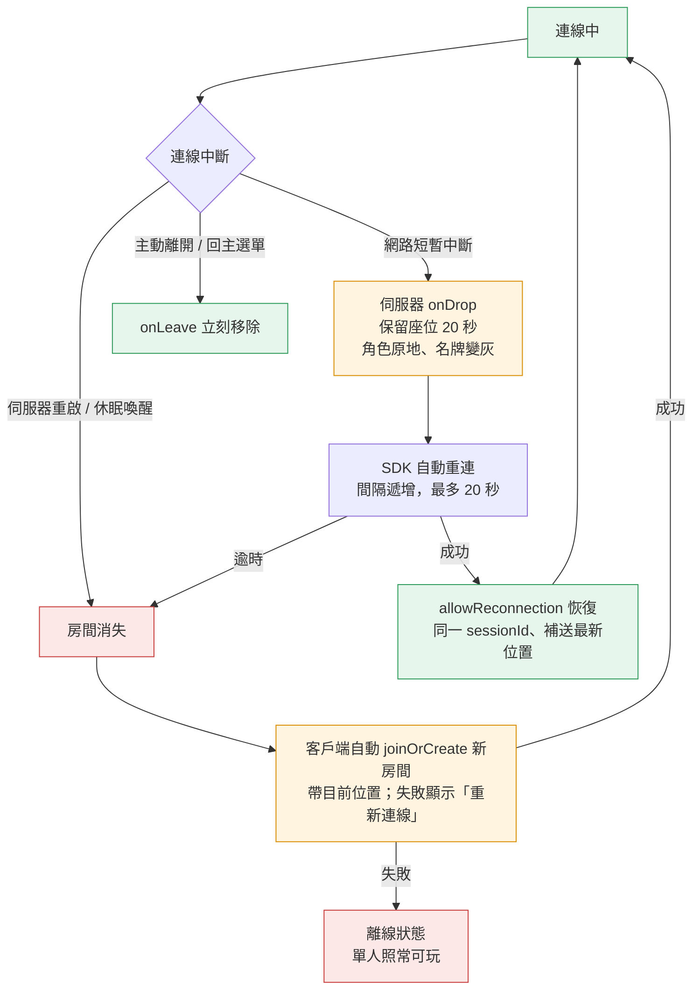
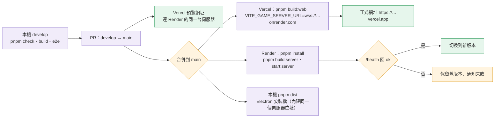
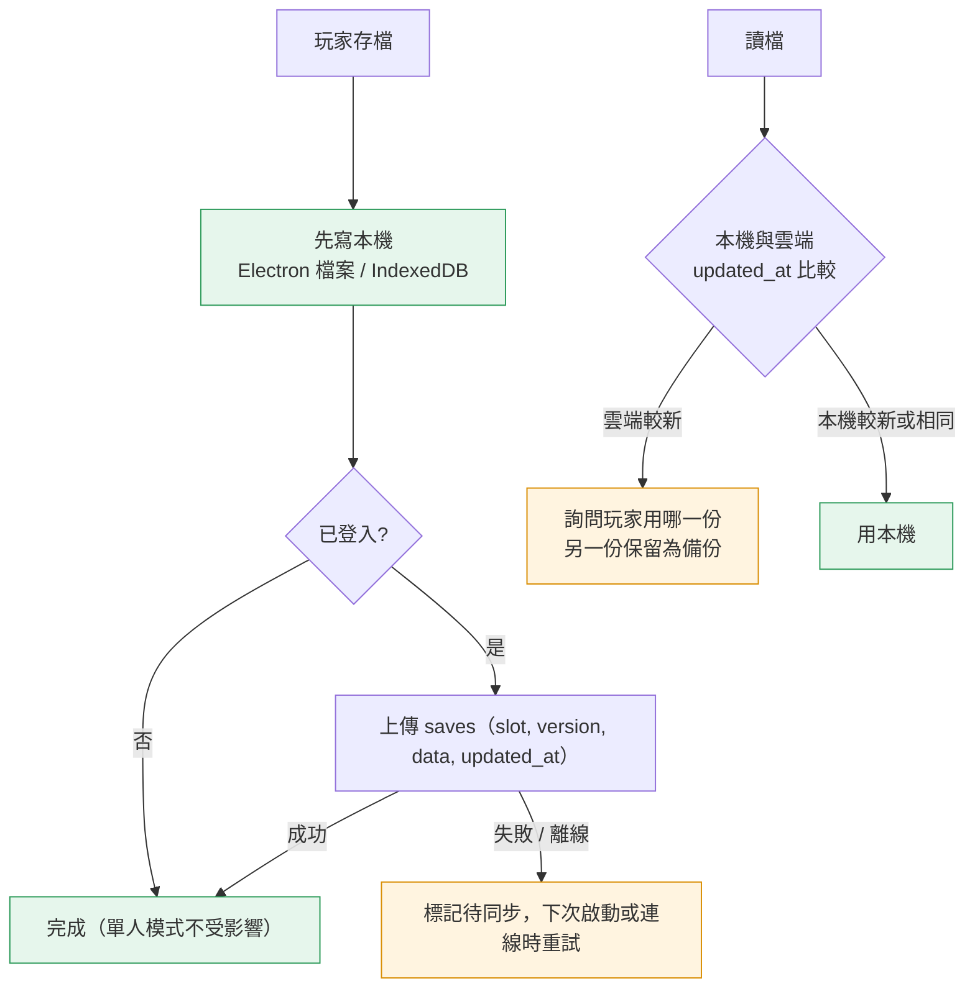

# 雙人連線整體規劃：架構、服務與流程（2026-10-15）

> 範圍：把已完成的區域連線（任務 11A–11B，Colyseus 在場層）推到「兩個人各自在網頁或桌面版登入，連到線上伺服器一起玩」。
> 本文件取代 `docs/LAUNCH_PLAN.md` §3–§4.3、§8–§10 的多人部分（那份草案原本建議 Supabase Realtime → Cloudflare Durable Objects；實作已改用 Colyseus，見 DECISIONS T-166）。網頁上線、資產壓縮、桌面簽章仍以 `LAUNCH_PLAN.md` 為準。
> 已完成部分的細節：`architecture.md`（元件與決策）、`protocol.md`（訊息格式）、`testing.md`（執行與測試）。
> 各服務的免費額度與條款會變動，下面的數字查於 2026-10，**開帳號前再看一次官方頁面**。

---

## 1. 一句話架構

**前端放 Vercel（靜態網站）＋桌面版 Electron（同一份程式碼）→ 用 WebSocket 連 Render 上的 Colyseus 遊戲伺服器 → 伺服器用 Supabase 驗證登入、讀寫雲端存檔。**

---

## 2. 服務與技術總表

### 2.1 外部服務（要開的帳號）

| 服務 | 用途 | 方案 | 何時需要 | 誰提供 |
|---|---|---|---|---|
| **GitHub**（`YisoTsao/misty-forest`） | 原始碼、觸發 Vercel / Render 自動部署 | 已有 | 已在用 | 已有 |
| **Vercel** | 網頁版前端（`pnpm build:web` 的 `dist/`）、HTTPS、CDN、每個 PR 的預覽網址 | Hobby（免費，**限非商業**） | Phase 4 | 你的帳號 |
| **Render** | 遊戲伺服器（Node 程序跑 Colyseus，`dist-server/server.mjs`），提供 `wss://` | Free Web Service（閒置 15 分鐘休眠，喚醒約 30–60 秒）；正式用 Starter（約 US$7／月，不休眠） | Phase 4 | 你的帳號 |
| **Supabase** | Auth（登入、JWT）、Postgres（玩家檔案、雲端存檔）、RLS | Free（**7 天沒活動會暫停**、500 MB DB） | Phase 5 | 你的專案 |
| Google Cloud OAuth（選用） | 「用 Google 登入」的 Client ID / Secret（設在 Supabase 後台） | 免費 | Phase 5，若要 Google 登入 | 你 |
| 自訂網域（選用） | 例如 `mistwood.xxx`，指到 Vercel；`play-server.xxx` 指到 Render | 約 US$10–15／年 | 隨時 | 你 |
| 錯誤回報（選用，之後） | Sentry 之類，收前端與伺服器的例外 | Free | Phase 6 之後 | — |

### 2.2 技術堆疊

| 層 | 技術 | 位置 | 狀態 |
|---|---|---|---|
| 3D 前端 | React 19、React Three Fiber 9、Three.js、Rapier、Tailwind 4、Vite | `src/` | 已有 |
| 桌面殼 | Electron 44、electron-builder（dmg / nsis） | `electron/` | 已有 |
| 共用規則 | `game-core`（純 TypeScript、zod 4 驗證）；多人協定 `game-core/net/` | `src/game-core/` | 已有 |
| 連線客戶端 | `@colyseus/sdk` 0.18（Web 與 Electron 同一份） | `src/net/` | 已有 |
| 遊戲伺服器 | `@colyseus/core` 0.18、`@colyseus/ws-transport`、`@colyseus/schema` 5、esbuild 打包、Node 24 | `server/` | 已有（本機） |
| 登入 | `@supabase/supabase-js`（前端）；伺服器用 `jose` 依 Supabase 的 JWKS 驗證 JWT（不需要 secret） | `src/net/auth.ts`、`server/auth.ts` | Phase 5 新增 |
| 資料庫 | Supabase Postgres＋RLS；伺服器用 secret key 寫入 | `supabase/migrations/` | Phase 5 新增 |
| 部署設定 | `render.yaml`（Blueprint）、`vercel.json`、`package.json` 的 `packageManager` | repo 根目錄 | Phase 4 新增 |
| 測試 | Vitest、`@colyseus/testing`、Playwright（Electron / Chromium e2e） | `e2e/`、`*.test.ts` | 已有，逐步擴充 |

---

## 3. 系統架構圖

重點：
- **Vercel 只放靜態檔**，不跑遊戲伺服器（Vercel Functions 的 WebSocket 會被切斷，也不保證同房間連到同一台）。
- **Render 只跑一個 Node 程序**，雙人到十幾人都夠；房間狀態在記憶體，伺服器重啟時房間消失、客戶端重連（Phase 3）。
- **secret key 只放 Render 的環境變數**，絕對不進前端、Electron 或 git。前端只拿 publishable key（公開也沒關係，靠 RLS 保護）。

---

## 4. 流程圖

### 4.1 雙人連線一次的完整流程（Phase 5 完成後）

### 4.2 斷線續玩（Phase 3）

### 4.3 部署流程（Phase 4）

### 4.4 雲端存檔與本機存檔（Phase 5）

---

## 5. 環境變數

| 變數 | 放哪裡 | 公開？ | 說明 |
|---|---|---|---|
| `VITE_GAME_SERVER_URL` | Vercel、本機 `.env`（Electron 建置時） | 公開 | `wss://<服務名>.onrender.com`；建置時寫進 CSP |
| `VITE_SUPABASE_URL` | Vercel、本機 `.env` | 公開 | `https://<project-ref>.supabase.co`；也要加進 CSP |
| `VITE_SUPABASE_PUBLISHABLE_KEY` | Vercel、本機 `.env` | 公開 | `sb_publishable_…`（舊稱 anon key） |
| `PORT` | Render 自動提供 | — | 伺服器已會讀 `PORT` |
| `NODE_VERSION` | Render | — | `24` |
| `ELECTRON_SKIP_BINARY_DOWNLOAD` | Render、Vercel | — | `1`，部署時不下載 Electron 執行檔（省時間） |
| `ALLOWED_ORIGINS` | Render | — | 正式網址、預覽網址樣式、Electron 的 `null` 來源 |
| `SUPABASE_URL` | Render | 公開 | 伺服器取 JWKS 用 |
| `SUPABASE_SECRET_KEY` | **只放 Render** | **機密** | `sb_secret_…`，寫雲端存檔用。**不要貼到對話、不要進 git** |

---

## 6. 階段路線圖（每一項單獨驗收）

| 階段 | 內容 | 需要的帳號 | 驗收 |
|---|---|---|---|
| ✅ 0–2（任務 11A–11B） | Colyseus 伺服器、在場玩家、移動同步、伺服器驗證 | — | `multiplayer` e2e 9 項 |
| **3 斷線續玩** | `onDrop` + `allowReconnection(20 s)`、SDK 自動重連、伺服器重啟後自動重新加入、依抖動調整的呈現延遲、依出入口資料驗證 `warp` 落點 | 不需要 | e2e：切斷網路 5 秒後恢復，對方看到同一個人回來（不是離開再加入）；伺服器重啟後自動回來 |
| **4 部署** | `render.yaml`、`vercel.json`、`packageManager`、來源允許清單、CSP、`/health` 健康檢查、Render 休眠時的「伺服器喚醒中」提示 | Vercel、Render | 正式網址兩個瀏覽器互相看到；Electron 安裝檔連到同一台伺服器；`/health` 正常 |
| **5 登入與雲端存檔** | Supabase Auth（Email 魔法連結，選用 Google）、`profiles`、`saves`＋RLS、伺服器驗證 JWT、Electron 的 `mistwood://` 回呼、存檔同步與衝突處理 | Supabase（選用 Google Cloud） | 網頁存檔 → 桌面讀到同一份；RLS 測試讀不到別人的存檔；沒有 token 不能加入房間 |
| 6 AOI 與權威 RPG 系統 | 興趣範圍、`RemoteAuthority`、敵人 AI 與傷害 / 掉落 / 任務進度改由伺服器判定（`LAUNCH_PLAN.md` M2–M5） | 同上 | 兩人一起打同一隻怪，血量與掉落一致 |

---

## 7. 安全與限制

- **來源允許清單**：Colyseus 預設接受任何來源；Phase 4 只允許正式網址、`*-yisotsao.vercel.app` 預覽網址與 Electron（`file://` 的 Origin 是 `null`，以 JWT 為主要防線）。
- **CSP**：`index.html` 的 `connect-src` 已會加入 `VITE_GAME_SERVER_URL`；Phase 5 再加 Supabase 網址。
- **伺服器權威**：移動驗證已在伺服器（T-168）；Phase 6 前任務、背包、戰鬥仍在各自本機，雙人時各自的進度不互相影響。
- **Render Free 休眠**：沒人連線 15 分鐘就休眠，第一個人連線要等 30–60 秒。封閉測試可接受；公開後改 Starter。不建議用外部定時請求硬撐不休眠（違反免費方案的用意，且每月 750 小時額度）。
- **Supabase Free 暫停**：7 天沒有活動會暫停專案，測試期每週至少開一次；正式上線改 Pro。
- **Vercel Hobby 限非商業**：有收費、廣告、贊助就要改 Pro。
- **憑證不進 git**：`.env*` 已排除；`.env.example` 只放公開設定。

---

## 8. 待決定（會影響實作）

1. 「雙人」是指房間上限 2 人，還是先用兩個人測試、上限維持 16？（目前 `maxClients: 16`）
2. 登入方式：只用 Email 魔法連結，還是加 Google？
3. 正式部署分支：`main`（建議，`develop` 合併後才上線）還是直接 `develop`？
4. 區域：Render 新加坡、Supabase 東京或新加坡（離台灣最近）。
5. 有沒有商業化打算（決定 Vercel / Render / Supabase 的方案）。
