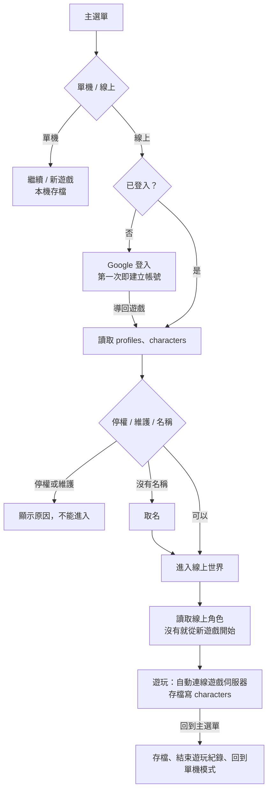

# 單機 / 線上的畫面與流程（任務 11L-2）

決策見 `docs/DECISIONS.md` T-179、T-180、T-184（Google 登入；LINE 已移除，T-188）；資料表見 `database.md`。

## 原則

- 主選單一開始就分「單機遊玩」「線上遊玩」兩頁，兩者資料完全分開：單機只用本機存檔，線上只用資料庫的線上角色，**不互相同步**。
- 線上一定要登入（Google，T-184、T-188）。第一次登入就自動建立並綁定帳號；登入後直接成為已登入狀態，不需要再按任何按鈕。
- 設定、離開兩頁共用。上次選的頁面記在本機（`localStorage` 的 `mistwood.titleMode`），第一次預設單機。

## 主選單

```
        迷霧之森：星光旅人
   在迷霧散去之前，找回森林的星光
      （game_config.motd，有設定時顯示）

   ┌──────────────────────────────┐
   │ [ 單機遊玩 ]  [ 線上遊玩 ]     │
   │  一行說明（進度存在哪裡）        │
   │ ……（依選擇的頁面）               │
   │ ───────────────────────────── │
   │ [ 設定 ]       [ 離開遊戲 ]    │
   └──────────────────────────────┘
```

- **單機遊玩**：繼續遊戲（有本機存檔時）、新遊戲（有存檔時要確認）。與原本相同。
- **線上遊玩**，依狀態顯示：

| 狀態 | 顯示 |
|---|---|
| 這個版本沒有設定線上服務 | 停用提示（開發與 e2e 建置） |
| 未登入 | 說明、「使用 Google 登入」 |
| 登入中 | 「請在開啟的瀏覽器頁面完成登入」、取消登入（桌面版）；網頁版直接整頁導向 |
| 已登入、讀取中 | 「讀取帳號資料中…」（讀取失敗有「再試一次」） |
| 停權中 | 停權說明、到期時間、原因（不能進入） |
| 維護中（一般玩家） | 維護訊息（gm / admin 不受限） |
| 還沒設定顯示名稱 | 取名（2–16 字、不能重複、不能含屏蔽詞） |
| 可以進入 | 線上角色的存檔時間與遊玩時間（或「還沒有線上角色」）、「進入線上世界」 |

已登入時上方一列顯示「已登入：名稱」與「登出」。

## 流程



## 遊戲中

- 暫停選單標題下方顯示目前的模式：「單機遊玩」或「線上遊玩 · 名稱」。
- 線上：「線上狀態」開啟連線面板（名稱固定為帳號的顯示名稱）；沒有「匯出存檔」（線上角色在資料庫）。
- 單機：沒有連線入口（線上一定要登入）。例外：沒有設定線上服務的開發建置保留「多人連線」，方便本機測試；網址 `?mp=1` 也維持自動連線（e2e 用）。
- 線上存檔以 `revision` 檢查：別的分頁或裝置已經存過時不覆蓋，提示「請回到主選單重新進入」，這一局之後不再存檔。
- 線上的一局會在 `player_sessions` 建立遊玩紀錄，每分鐘更新一次，回到主選單或關閉視窗時寫入結束時間。
